<div align="center">

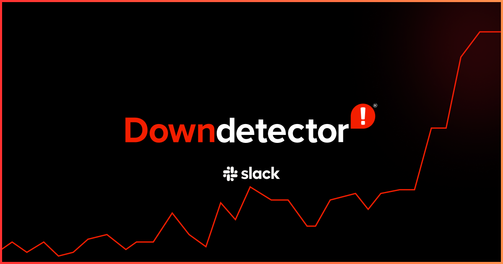

</div>

<div align="center">

[](https://www.typescriptlang.org/)
[](https://docs.slack.dev/)
[](https://github.com/daijro/camoufox)
[](https://prometheus.io/)
[](https://grafana.com/)

**[🇧🇷 Português](#-português)**

[Configuração](#configuração) • [Uso](#uso) • [Observabilidade](#observabilidade) • [Testes](#testes) • [Contribuição](#contribuição)

**Monitoramento automatizado em tempo real de serviços financeiros brasileiros usando Downdetector**

**[🇨🇱 Español](#-español)**

[Configuración](#configuración) • [Modo de Uso](#modo-de-uso) • [Observabilidad](#observabilidad) • [Pruebas](#pruebas) • [Contribución](#contribución)

**Monitoreo automatizado en tiempo real de los servicios financieros brasileños mediante Downdetector**

</div>

---

# 🇧🇷 Português

## Por que este projeto existe?

Este bot foi criado para **detectar instabilidades** reportadas no **[Downdetector Brasil](https://downdetector.com.br/)** e notificar automaticamente canais do **[Slack](https://slack.com/intl/pt-br/)** sobre potenciais problemas que afetem serviços financeiros brasileiros.

A ideia é permitir que equipes técnicas **correlacionem incidentes externos com problemas internos**, como a abertura de chamados relacionados a um determinado serviço ou sistemas que dependam da disponibilidade desses serviços.

Com essas informações em tempo real, é possível **identificar possíveis causas externas, antecipar impactos e agir antes que uma instabilidade se transforme em um problema maior**.

### Desafio

O Downdetector é protegido pelo **Cloudflare Turnstile**, que bloqueia scraping automatizado de IPs de datacenter (Railway, AWS, GCP). Ferramentas padrão (Playwright, Puppeteer) são detectadas no nível JavaScript e bloqueadas.

### Solução

O projeto utiliza o **[Camoufox](https://github.com/daijro/camoufox)**, um fork do Firefox voltado à redução de sinais de automação do navegador. O navegador é executado em modo **headed** (com interface gráfica) dentro de um display virtual (**Xvfb**), permitindo que o Firefox rode de forma invisível em um ambiente de servidor.

### Agradecimentos e Créditos

Este projeto foi construído utilizando a versão TS do **[Camoufox](https://github.com/apify/camoufox-js)** criado por **[daijro](https://github.com/daijro)**.

Fica aqui o agradecimento aos desenvolvedores por disponibilizarem essa excelente ferramenta para a comunidade, onde tive a honra de colaborar com meu primeiro PR, MUITO OBRIGADO !

---

## Funcionalidades

- **Headed + Xvfb**: o navegador roda com interface gráfica em um display virtual, mesmo dentro de um servidor, inicializado via [`xvfb.sh`](xvfb.sh)
- **Um context por ciclo**: os serviços compartilham um único context (`NewContext()`) criado a cada ciclo, com uma `newPage()` por serviço. Assim os cookies (como os do Cloudflare) são reaproveitados dentro do ciclo, e o context é fechado no final dele
- **Parsing PT-BR**: o status é identificado a partir dos textos exibidos pelo Downdetector em português
- **Retry automático**: uma consulta que falha recebe uma segunda tentativa (`checkWithRetry()` em [`downdetector.ts`](src/providers/downdetector.ts)) antes de ser descartada
- **Ciclo contínuo com atraso aleatório**: o monitoramento roda uma vez ao iniciar e depois se reagenda sozinho, com um intervalo aleatório de 15 a 30 segundos entre os ciclos ([`monitorLoop.ts`](src/jobs/monitorLoop.ts))
- **Alertas via Incoming Webhooks do Slack**: `danger` dispara um alerta crítico em dois canais; quando o serviço volta pra `success`, o bot manda a resolução com a duração do incidente. `warning` só aparece no log
- **Alertas de erro internos em dois canais**: se nenhum serviço puder ser verificado em um ciclo, o bot dispara uma DM direta ou canal (depende do tipo de webhook que chamada)(visível em qualquer client, incluindo mobile), [`sendError()`](src/notifiers/slack.ts)
- **Validação fail-fast de variáveis de ambiente**: o bot falha logo na inicialização se algum webhook estiver faltando ([`env.ts`](src/config/env.ts)), evitando deploys silenciosamente quebrados
- **Fechamento robusto do browser**: [`forceCloseBrowser()`](src/providers/closeBrowser.ts) tenta o fechamento normal com timeout de 2s e só registra o erro no momento se não confirmar
- **Init próprio (tini)**: tini é usado como PID 1 no container pra fazer reap de processos
- **Docker**: imagem com Xvfb e as dependências do Firefox, pronta pra rodar em container
- **Testes**: testes unitários com Vitest e script manual pra testar alertas no Slack
- **Observabilidade (pausada)**: Prometheus e Grafana já estão no repositório, mas desativados por enquanto. Veja [Observabilidade](#observabilidade)

---

## Serviços monitorados

<details>
<summary>Clique para expandir</summary>

| Serviço             | URL                                                                                                        |
| ------------------- | ---------------------------------------------------------------------------------------------------------- |
| **PIX**             | [downdetector.com.br/fora-do-ar/pix/](https://downdetector.com.br/fora-do-ar/pix/)                         |
| **Itaú**            | [downdetector.com.br/fora-do-ar/banco-itau/](https://downdetector.com.br/fora-do-ar/banco-itau/)           |
| **Bradesco**        | [downdetector.com.br/fora-do-ar/bradesco/](https://downdetector.com.br/fora-do-ar/bradesco/)               |
| **Santander**       | [downdetector.com.br/fora-do-ar/santander/](https://downdetector.com.br/fora-do-ar/santander/)             |
| **Nubank**          | [downdetector.com.br/fora-do-ar/nubank/](https://downdetector.com.br/fora-do-ar/nubank/)                   |
| **Banco do Brasil** | [downdetector.com.br/fora-do-ar/banco-do-brasil/](https://downdetector.com.br/fora-do-ar/banco-do-brasil/) |
| **Mercado Pago**    | [downdetector.com.br/fora-do-ar/mercadopago/](https://downdetector.com.br/fora-do-ar/mercadopago/)         |
| **PicPay**          | [downdetector.com.br/fora-do-ar/picpay/](https://downdetector.com.br/fora-do-ar/picpay/)                   |
| **Cielo**           | [downdetector.com.br/fora-do-ar/cielo/](https://downdetector.com.br/fora-do-ar/cielo/)                     |

</details>

---

## Adicionando novos serviços

<details>
<summary>Clique para expandir</summary>

O bot foi estruturado para que novos serviços do Downdetector possam ser adicionados **sem alterar a lógica principal do scraper**. Só é preciso mexer em **1 arquivo**, [`services.ts`](src/config/services.ts):

```typescript
const SERVICES: MonitoredService[] = [
	// ... serviços existentes
	{
		name: "Banco do Brasil",
		url: "https://downdetector.com.br/fora-do-ar/slug-do-servico/",
	},
];
```

#### Como os monitores são criados automaticamente ??

Os monitores de incidente são criados dinamicamente a partir dessa lista, em [`notificationOrchestrator.ts`](src/jobs/notificationOrchestrator.ts). Após o push (ou reinício do container), o novo serviço passa a ser monitorado no próximo ciclo.

```typescript
const monitors = new Map<string, IncidentMonitor>();

for (const service of SERVICES) {
	monitors.set(service.name, new IncidentMonitor(slackNotifier));
}
```

#### Finalizando

Após o push (ou reinício do container), o novo serviço passa a ser monitorado automaticamente no próximo ciclo.

> 💡 **Dica:** não esqueça de atualizar também a tabela [Serviços monitorados](#serviços-monitorados) e, se quiser vê-lo no Grafana, adicione um novo painel `stat` em [downdetector.json](monitoring/grafana/provisioning/dashboards/downdetector.json) apontando pra label normalizada do serviço (veja [Observabilidade](#observabilidade)).

</details>

---

## Adaptando o projeto para outro idioma

<details>
<summary>Clique para expandir</summary>

O bot lê os **textos exibidos** na página do Downdetector, então trocar de idioma exige ajustar **três pontos**, todos em [`downdetector.ts`](src/providers/downdetector.ts):

#### 1. O idioma enviado ao site

Em `checkSingleService()`, troque o `Accept-Language`:

```typescript
// Exemplo: Chile
await page.setExtraHTTPHeaders({
	"Accept-Language": "es-CL,es;q=0.9,en-US;q=0.8,en;q=0.7",
});
```

#### 2. O texto que indica que a página carregou

`waitForRealContent()` espera aparecer `"relatos dos usuários"` ou `"relatos de usuários"`. Troque pelo texto equivalente da página no seu idioma, senão toda checagem estoura o timeout.

#### 3. As frases de status

`detectStatus()` identifica o estado do serviço procurando frases no texto da página:

```typescript
async function detectStatus(page: Page): Promise<ServiceStatus | null> {
    try {
        ...
        ...
        if (body.includes("não mostram problemas")) return "success";
         if (body.includes("possíveis problemas")) return "warning";
          if (body.includes("mostram problemas")) return "danger";
           return false
        ...
        ...
        ...
        }
}
```

| Status    | PT-BR                   | ES-CL                   |
| --------- | ----------------------- | ----------------------- |
| `SUCCESS` | `não mostram problemas` | `no muestran problemas` |
| `WARNING` | `possíveis problemas`   | `posibles problemas`    |
| `DANGER`  | `mostram problemas`     | `muestran problemas`    |

> ⚠️ **Atenção:** a ordem das verificações importa! No PT-BR e no ES-CL, a frase de `SUCCESS` contém a frase de `DANGER` como substring (ex: `"não mostram problemas"` contém `"mostram problemas"`). Por isso `SUCCESS` é verificado **antes** de `DANGER` no código, se você adaptar para outro idioma, verifique se as frases do seu idioma têm esse mesmo tipo de sobreposição antes de definir a ordem dos `if`.

> 💡 **Dica de debug:** se o parser deixar de reconhecer um status (o Downdetector pode mudar os textos com o tempo), abra a página no navegador, inspecione o texto exibido e atualize as frases.

</details>

---

## Estrutura do projeto

<details>
<summary>Clique para expandir a árvore de arquivos</summary>

```
├── docker-compose.yml
├── Dockerfile
├── Dockerfile.grafana
├── Dockerfile.prometheus
├── .dockerignore
├── .env.example
├── .github
│   ├── assets
│   │   ├── banner.png
│   │   ├── es-CL
│   │   │   ├── dd-danger.png
│   │   │   ├── dd-success.png
│   │   │   └── dd-warning.png
│   │   ├── grafana
│   │   │   └── dashboard.png
│   │   └── pt-BR
│   │       ├── alert-critical.png
│   │       ├── alert-resolved.png
│   │       ├── dd-danger.png
│   │       ├── dd-success.png
│   │       └── dd-warning.png
│   └── workflows
│       └── ci.yml
├── .gitignore
├── LICENSE
├── manifest.yml
├── monitoring
│   ├── grafana
│   │   ├── logos
│   │   │   ├── bancodobrasil.png
│   │   │   ├── bradesco.png
│   │   │   ├── itau.png
│   │   │   ├── mercadopago.png
│   │   │   ├── nubank.png
│   │   │   ├── picpay.png
│   │   │   ├── pix.png
│   │   │   └── santander.png
│   │   └── provisioning
│   │       ├── dashboards
│   │       │   ├── dashboards.yml
│   │       │   └── downdetector.json
│   │       └── datasources
│   │           └── datasource.yml
│   └── prometheus
│       ├── prometheus.railway.yml
│       ├── prometheus.yml
│       └── railway
│           └── prometheus-datasource.yml
├── package.json
├── pnpm-lock.yaml
├── pnpm-workspace.yaml
├── README.md
├── scripts
│   └── realAlertTest.ts
├── src
│   ├── config
│   │   ├── env.ts
│   │   └── services.ts
│   ├── core
│   │   ├── incidentMonitor.ts
│   │   └── types.ts
│   ├── jobs
│   │   ├── monitorLoop.ts
│   │   └── notificationOrchestrator.ts
│   ├── main.ts
│   ├── metrics
│   │   └── prometheusClient.ts
│   ├── notifiers
│   │   └── slack.ts
│   ├── providers
│   │   ├── browser.ts
│   │   ├── closeBrowser.ts
│   │   └── downdetector.ts
│   └── utils
│       └── helpers.ts
├── tests
│   ├── integration
│   │   └── slackNotifier.spec.ts
│   └── unit
│       └── incidentMonitor.spec.ts
├── tsconfig.json
├── vitest.config.ts
├── xvfb.sh
└── .zed
```

</details>

## Arquitetura

<details>
<summary>Clique para expandir/recolher diagrama</summary>

### Fluxo do sistema

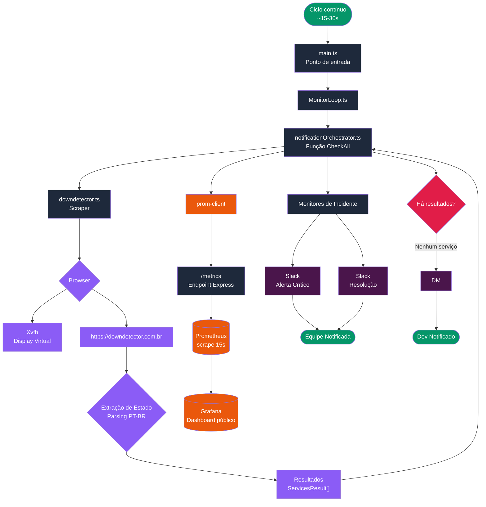

### Diagrama de componentes

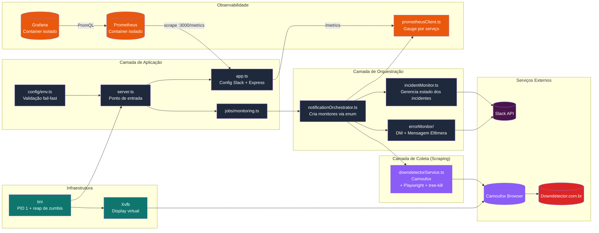

</details>

---

## Como os alertas funcionam

<details>
<summary>Clique para entender</summary>

Cada serviço tem seu próprio monitor de incidente que acompanha as mudanças de status:

| Status no Downdetector | O que significa                                              | Ação no Slack                               | Valor no Grafana |
| ---------------------- | ------------------------------------------------------------ | ------------------------------------------- | ---------------- |
| 🟢 **Success**         | Relatos dos usuários **não indicam problemas** com o serviço | Nenhuma ação (estado normal)                | `0`              |
| 🟡 **Warning**         | Relatos mostram **possíveis problemas** com o serviço        | ⚠️ Apenas logado (sem alerta)               | `1`              |
| 🔴 **Danger**          | Relatos mostram **problemas confirmados** com o serviço      | ☠️ **Alerta Crítico** enviado imediatamente | `2`              |

</details>

## Exemplos visuais dos status no Downdetector

<details>
<summary>Clique para ver como cada status aparece no Downdetector</summary>

#### 🟢 Success → Serviço operando normalmente

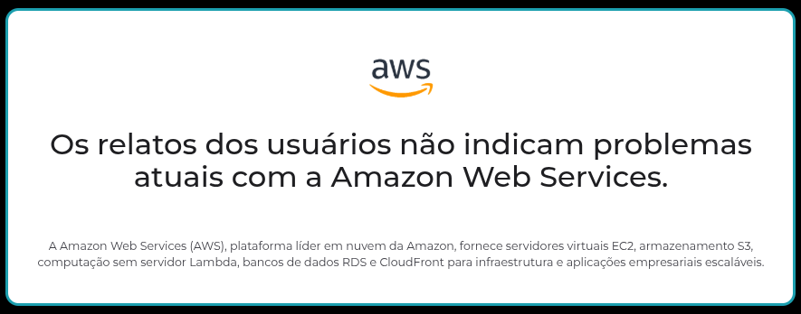

_"Os relatos dos usuários não indicam problemas atuais com o WhatsApp."_

#### 🟡 Warning → Possíveis problemas detectados

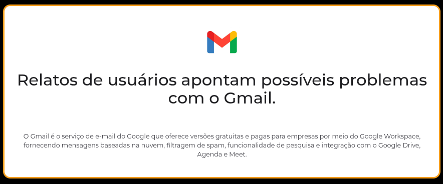

_"Relatos de usuários mostram possíveis problemas com WhatsApp."_

#### 🔴 Danger → Problemas confirmados


_"Relatos de usuários mostram problemas com WhatsApp."_

</details>

## Exemplos de notificações no Slack

<details>
<summary>Clique para ver como os alertas aparecem no Slack</summary>

#### ☠️ Alerta Crítico (quando o serviço entra em `danger`)

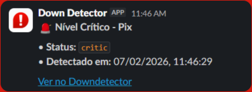

#### 🎉 Alerta de Resolução (quando o serviço volta pra `success`)

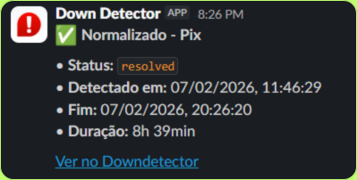

</details>

---

## Configuração

## Pré-requisitos

- Node.js 22.15+ e [pnpm](https://pnpm.io/)
- Um app do Slack com Incoming Webhooks ([crie um aqui](https://api.slack.com/apps))
- Docker (opcional, roda o mesmo ambiente com Xvfb)

## Instalação

<details>
<summary>Clique para expandir as instruções de setup</summary>

1. **Clone o repositório**

```bash
git clone https://github.com/eduardotashiro/downdetector-slack.git
cd downdetector-slack
```

2. **Instale as dependências**

```bash
pnpm install
```

3. **Baixe o navegador** (o `pnpm install` não baixa o binário do Camoufox; o Dockerfile faz o mesmo comando)

```bash
npx camoufox fetch
```

4. **Configure as variáveis de ambiente**

```bash
cp .env.example .env
```

Depois, preencha o `.env` com os 3 webhooks (veja a próxima seção):

```env
SLACK_WEBHOOK_ALERT_1=https://hooks.slack.com/services/...
SLACK_WEBHOOK_ALERT_2=https://hooks.slack.com/services/...
SLACK_WEBHOOK_ERROR=https://hooks.slack.com/services/...
```

5. **Compile o projeto**

```bash
pnpm run build
```

6. **Inicie o bot**

```bash
pnpm start
```

</details>

### Webhooks do Slack

<details>

<summary>Clique para expandir as instruções</summary>

1. Acesse https://api.slack.com/apps e clique em **Create New App**

2. Crie do zero, ou escolha **From an app manifest** e cole o conteúdo de [`manifest.yml`](manifest.yml)

3. Em **Incoming Webhooks**, ative a opção e clique em **Add New Webhook to Workspace**, escolhendo o canal. Faça isso uma vez por variável:

    - `SLACK_WEBHOOK_ALERT_1` e `SLACK_WEBHOOK_ALERT_2` → canais que recebem os alertas críticos e as resoluções

    - `SLACK_WEBHOOK_ERROR` → canal que recebe os erros do próprio bot

4. Copie cada URL pro `.env`

> Documentação: [Envio de mensagens usando webhooks](https://docs.slack.dev/messaging/sending-messages-using-incoming-webhooks/)

</details>

### Docker

<details>
<summary>Clique para expandir as instruções de Docker</summary>

O Camoufox roda em modo **headed** (não headless) aqui, pois passa pelo Cloudflare de forma bem mais confiável. Como não tem monitor físico, a imagem Docker roda ele dentro de um display virtual (Xvfb).

**Só o bot (build e execução local):**

```bash
docker build -t downdetector-slack .
docker run --rm -it --env-file .env downdetector-slack
```

**Stack completa local (bot + Prometheus + Grafana) via Docker Compose:**

```bash
docker compose up --build
```

Isso sobe três containers na mesma rede (`monitoring`):

- `bot` → expõe `:3000` (inclui `/metrics`)
- `prometheus` → `:9090`, faz scrape do bot a cada 15s
- `grafana` → `:3001`, já vem com o datasource e o dashboard provisionados automaticamente login padrão `admin` / `admin`, definido em [docker-compose.yml](docker-compose.yml)

Não precisa mapear porta do bot em produção, pois ele nunca recebe tráfego HTTP externo além do scrape do Prometheus (`/metrics`) e das requisições de saída pro Downdetector e pro Slack.

</details>

---

## Uso

<details>
<summary>Clique para expandir exemplos de uso</summary>

**Modo Desenvolvimento:**

```bash
pnpm run dev
```

Roda com hot-reload usando `tsx watch`. No Linux sem display, envolva com `xvfb-run -a npm run dev`.

**Modo Produção:**

```bash
pnpm run build
pnpm start
```

> Na primeira execução o Camoufox baixa uma base GeoIP (`geoip: true`), então o primeiro ciclo demora mais.

</details>

---

## Observabilidade

<details>
<summary>Clique para expandir/recolher</summary>

> ⏸️ **Desativada por enquanto.** Os arquivos de Prometheus e Grafana estão no repositório, mas nada expõe o `/metrics` ainda.

O bot expõe métricas no formato Prometheus e vem com um dashboard Grafana pronto, provisionado automaticamente, sem precisar configurar nada manualmente.

### Métrica exposta

O endpoint `GET /metrics` expõe a métrica `downdetector_service_status`, um `Gauge` por serviço, definido em [`src/metrics/prometheusClient.ts`](src/metrics/prometheusClient.ts):

```
# HELP downdetector_service_status Status do serviço monitorado pelo Downdetector: 0 = success, 1 = warning, 2 = danger
# TYPE downdetector_service_status gauge
downdetector_service_status{service="pix"} 0
downdetector_service_status{service="nubank"} 0
downdetector_service_status{service="banco_itau"} 2
```

O label `service` é gerado a partir do nome do serviço, normalizado (minúsculo, sem acento, espaços viram `_`) pela função `normalizeServiceName()`.

### Dashboard Grafana

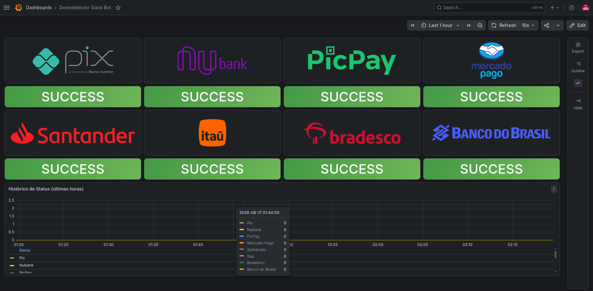

O dashboard [`downdetector.json`](monitoring/grafana/provisioning/dashboards/downdetector.json) é carregado automaticamente pelo provider configurado em [`dashboards.yml`](monitoring/grafana/provisioning/dashboards/dashboards.yml), e mostra:

- Um painel `stat` por serviço, com cor verde/amarelo/vermelho de acordo com o status atual (`SUCCESS` / `WARNING` / `DANGER`)
- Um painel `timeseries` com o histórico de status de todos os serviços nas últimas horas

O datasource do Prometheus também é provisionado automaticamente:

- Localmente, via [`datasource.yml`](monitoring/grafana/provisioning/datasources/datasource.yml) (`http://prometheus:9090`)
- No Railway, via [`prometheus-datasource.yml`](monitoring/prometheus/railway/prometheus-datasource.yml) (`http://prometheus.railway.internal:9090`)

### Rodando localmente

```bash
docker compose up --build
```

- Grafana: [http://localhost:3001](http://localhost:3001) (login `admin` / `admin`)
- Prometheus: [http://localhost:9090](http://localhost:9090)
- Métricas cruas do bot: [http://localhost:3000/metrics](http://localhost:3000/metrics)

</details>

---

## Testes

<details>
<summary>Clique para expandir o guia de testes</summary>

**Rodar os testes:**

```bash
pnpm test            # Roda os testes uma vez
pnpm run test:watch  # Modo watch
```

**Testar alertas no seu canal do Slack:**
Manda um alerta DANGER real seguido de uma resolução SUCCESS pro canal configurado no seu `.env`, sem mexer nos monitores de produção:

```bash
pnpm run test:alert
```

</details>

---

## Contribuição

<details>
<summary>Clique para expandir o guia de contribuição</summary>

1. Faça um fork do repositório
2. Crie uma branch de feature

```bash
git checkout -b feature/minha-feature-bacan
```

3. Faça commit das suas mudanças (use [Conventional Commits](https://www.conventionalcommits.org/))

```bash
git commit -m 'feat: adiciona feature bacan'
```

4. Suba pra branch

```bash
git push origin feature/minha-feature-bacan
```

5. Abra um Pull Request

**Convenção de commits:** `feat`, `fix`, `docs`, `test`, `perf`, `refactor`, `chore`

**Antes de submeter o PR:**

```bash
pnpm test              # Roda os testes
pnpm run build         # Verifica se o build funciona
```

</details>

---

## Licença

Esse projeto está licenciado sob a Licença MIT - veja o arquivo [LICENSE](LICENSE) pra detalhes.

---

---

# 🇨🇱 Español

## ¿Por qué existe este proyecto?

Este bot fue creado para **detectar inestabilidades** reportadas en **[Downdetector Brasil](https://downdetector.com.br/)** y notificar automáticamente a canales de **[Slack](https://slack.com/intl/es-la/)** sobre posibles problemas que afecten a servicios financieros brasileños.

La idea es permitir que los equipos técnicos **correlacionen incidentes externos con problemas internos**, como la apertura de tickets relacionados con un servicio determinado o sistemas que dependan de la disponibilidad de esos servicios.

Con esta información en tiempo real, es posible **identificar posibles causas externas, anticipar impactos y actuar antes de que una inestabilidad se convierta en un problema mayor**.

### El desafío

Downdetector está protegido por **Cloudflare Turnstile**, que bloquea el scraping automatizado desde IPs de datacenter (Railway, AWS, GCP). Las herramientas estándar (Playwright, Puppeteer) son detectadas a nivel de JavaScript y bloqueadas.

### La solución

El proyecto utiliza **[Camoufox](https://github.com/daijro/camoufox)**, un fork de Firefox orientado a reducir las señales de automatización del navegador. El navegador se ejecuta en modo **headed** (con interfaz gráfica) dentro de un display virtual (**Xvfb**), lo que permite que Firefox corra de forma invisible en un entorno de servidor.

### Agradecimientos y Créditos

Este proyecto fue construido utilizando la versión TS de **[Camoufox](https://github.com/apify/camoufox-js)**, creado por **[daijro](https://github.com/daijro)**.

Queda aquí el agradecimiento a los desarrolladores por poner esta excelente herramienta a disposición de la comunidad, donde tuve el honor de colaborar con mi primer PR. ¡MUCHAS GRACIAS!

---

## Funcionalidades

- **Headed + Xvfb**: el navegador se ejecuta con interfaz gráfica en un display virtual, incluso dentro de un servidor, inicializado mediante [`xvfb.sh`](xvfb.sh)
- **Contexto compartido por ciclo**: los servicios se verifican dentro de un único contexto (`NewContext()`) creado en cada ciclo, con una `newPage()` por servicio; así las cookies (como las de Cloudflare) se comparten entre las verificaciones del mismo ciclo, y el contexto se cierra al final de este
- **Parsing PT-BR**: el estado se identifica a partir de los textos que muestra Downdetector en portugués, y el navegador envía `Accept-Language` priorizando pt-BR
- **Reintento automático**: una consulta que falla recibe un segundo intento (`checkWithRetry()` en [`downdetector.ts`](src/providers/downdetector.ts)) antes de ser descartada
- **Ciclo continuo con retraso aleatorio**: el monitoreo se ejecuta una vez al iniciar y luego se reprograma solo, con un intervalo aleatorio de 15 a 30 segundos entre ciclos ([`monitorLoop.ts`](src/jobs/monitorLoop.ts))
- **Alertas vía Incoming Webhooks de Slack**: `danger` dispara una alerta crítica en dos canales; cuando el servicio vuelve a `success`, el bot envía la resolución con la duración del incidente. `warning` solo aparece en el log
- **Alerta de error interno**: si ningún servicio puede ser verificado en un ciclo, el bot avisa en un canal aparte, [`sendError()`](src/notifiers/slack.ts)
- **Validación fail-fast de variables de entorno**: el bot falla de inmediato al iniciar si falta algún webhook ([`env.ts`](src/config/env.ts)), evitando despliegues silenciosamente rotos
- **Cierre robusto del navegador**: [`forceCloseBrowser()`](src/providers/closeBrowser.ts) intenta el cierre normal con un timeout de 2s y solo registra el error si no se confirma
- **Init propio (tini)**: tini se usa como PID 1 en el contenedor para hacer reap de procesos
- **Docker**: imagen con Xvfb y las dependencias de Firefox, lista para correr en un contenedor (ej.: Railway)
- **Pruebas**: pruebas unitarias con Vitest y script manual para probar alertas en Slack
- **Observabilidad (en pausa)**: Prometheus y Grafana ya están en el repositorio, pero desactivados por ahora. Ver [Observabilidad](#observabilidad)

---

## Servicios monitoreados

<details>
<summary>Haz clic para expandir</summary>

| Servicio            | URL                                                                                                        |
| ------------------- | ---------------------------------------------------------------------------------------------------------- |
| **PIX**             | [downdetector.com.br/fora-do-ar/pix/](https://downdetector.com.br/fora-do-ar/pix/)                         |
| **Itaú**            | [downdetector.com.br/fora-do-ar/banco-itau/](https://downdetector.com.br/fora-do-ar/banco-itau/)           |
| **Bradesco**        | [downdetector.com.br/fora-do-ar/bradesco/](https://downdetector.com.br/fora-do-ar/bradesco/)               |
| **Santander**       | [downdetector.com.br/fora-do-ar/santander/](https://downdetector.com.br/fora-do-ar/santander/)             |
| **Nubank**          | [downdetector.com.br/fora-do-ar/nubank/](https://downdetector.com.br/fora-do-ar/nubank/)                   |
| **Banco do Brasil** | [downdetector.com.br/fora-do-ar/banco-do-brasil/](https://downdetector.com.br/fora-do-ar/banco-do-brasil/) |
| **Mercado Pago**    | [downdetector.com.br/fora-do-ar/mercadopago/](https://downdetector.com.br/fora-do-ar/mercadopago/)         |
| **PicPay**          | [downdetector.com.br/fora-do-ar/picpay/](https://downdetector.com.br/fora-do-ar/picpay/)                   |
| **Cielo**           | [downdetector.com.br/fora-do-ar/cielo/](https://downdetector.com.br/fora-do-ar/cielo/)                     |

</details>

---

## Añadiendo nuevos servicios

<details>
<summary>Haz clic para expandir</summary>

El bot fue estructurado para que se puedan agregar nuevos servicios de Downdetector **sin modificar la lógica principal del scraper**. Solo hay que tocar **1 archivo**, [`services.ts`](src/config/services.ts):

#### 1. [services.ts](src/config/services.ts) → incluye el servicio en la lista de scraping

Agrega `name` y `url` al array:

```typescript
export const SERVICES: MonitoredService[] = [
	// ... servicios existentes
	{
		name: "Nombre del Servicio",
		url: "https://downdetector.com.br/fora-do-ar/slug-del-servicio/",
	},
];
```

#### ¿Cómo se crean los monitores automáticamente?

Los monitores de incidentes se crean dinámicamente a partir de esa lista, en [`notificationOrchestrator.ts`](src/jobs/notificationOrchestrator.ts). Después del push (o reinicio del contenedor), el nuevo servicio pasa a monitorearse en el próximo ciclo.

```typescript
const monitors = new Map<string, IncidentMonitor>();

for (const service of SERVICES) {
	monitors.set(service.name, new IncidentMonitor(slackNotifier));
}
```

#### Para finalizar

> 💡 **Tip:** no olvides actualizar también la tabla [Servicios monitoreados](#servicios-monitoreados) y, si quieres verlo en Grafana, agrega un nuevo panel `stat` en [downdetector.json](monitoring/grafana/provisioning/dashboards/downdetector.json) apuntando a la etiqueta normalizada del servicio (ver [Observabilidad](#observabilidad)).

</details>

---

## Adaptando el proyecto a otro idioma

<details>
<summary>Haz clic para expandir</summary>

El parser de estado depende de los **textos que muestra** la página de Downdetector. Actualmente el proyecto prioriza `pt-BR` a través del header `Accept-Language`:

```typescript
// src/providers/downdetector.ts
await page.setExtraHTTPHeaders({
	"Accept-Language": "pt-BR,pt;q=0.9,en-US;q=0.8,en;q=0.7",
});
```

Para adaptar el proyecto a otro idioma, hay que ajustar **dos puntos**:

#### 1. Cambiar el idioma enviado al sitio

En el archivo `src/providers/downdetector.ts`, cambia el `Accept-Language` al idioma deseado:

```typescript
// Ejemplo: Chile
await page.setExtraHTTPHeaders({
	"Accept-Language": "es-CL,es;q=0.9,en-US;q=0.8,en;q=0.7",
});
```

#### 2. Adaptar las expresiones del parser

`waitForRealContent()` espera que aparezca `"relatos dos usuários"` o `"relatos de usuários"`. Cámbialo por el texto equivalente de la página en tu idioma; si no, todas las verificaciones terminan en timeout.

La función `detectStatus()` identifica el estado del servicio buscando frases específicas en el texto de la página:

```typescript
// src/providers/downdetector.ts
async function detectStatus(page: Page): Promise<ServiceStatus | null> {
	try {
		const statusString = await page.evaluate(() => {
			const body = document.body?.innerText?.toLowerCase() || "";
			if (body.includes("não mostram problemas")) return "success";
			if (body.includes("possíveis problemas")) return "warning";
			if (body.includes("mostram problemas")) return "danger";
			return false;
		});
		// ...
	}
	// ...
}
```

Para otros idiomas, reemplaza las strings por sus equivalentes. Algunos ejemplos:

| Estado    | PT-BR                   | ES-CL                   |
| --------- | ----------------------- | ----------------------- |
| `SUCCESS` | `não mostram problemas` | `no muestran problemas` |
| `WARNING` | `possíveis problemas`   | `posibles problemas`    |
| `DANGER`  | `mostram problemas`     | `muestran problemas`    |

> ⚠️ **Atención:** ¡el orden de las comprobaciones importa! En PT-BR y en ES-CL, la frase de `SUCCESS` contiene la frase de `DANGER` como subcadena (ej: `"não mostram problemas"` contiene `"mostram problemas"`). Por eso `SUCCESS` se comprueba **antes** que `DANGER` en el código. Si lo adaptas a otro idioma, verifica si las frases de tu idioma tienen este mismo tipo de superposición antes de definir el orden de los `if`.

> 💡 **Tip de debug:** si el parser deja de reconocer un estado (Downdetector puede cambiar los textos con el tiempo), abre la página en tu navegador, inspecciona el texto mostrado y actualiza las expresiones de la función `detectStatus()` según sea necesario.

</details>

---

## Estructura del proyecto

<details>
<summary>Haz clic para expandir el árbol de archivos</summary>

```
├── docker-compose.yml
├── Dockerfile
├── Dockerfile.grafana
├── Dockerfile.prometheus
├── .dockerignore
├── .env.example
├── .github
│   ├── assets
│   │   ├── banner.png
│   │   ├── es-CL
│   │   │   ├── dd-danger.png
│   │   │   ├── dd-success.png
│   │   │   └── dd-warning.png
│   │   ├── grafana
│   │   │   └── dashboard.png
│   │   └── pt-BR
│   │       ├── alert-critical.png
│   │       ├── alert-resolved.png
│   │       ├── dd-danger.png
│   │       ├── dd-success.png
│   │       └── dd-warning.png
│   └── workflows
│       └── ci.yml
├── .gitignore
├── LICENSE
├── manifest.yml
├── monitoring
│   ├── grafana
│   │   ├── logos
│   │   │   ├── bancodobrasil.png
│   │   │   ├── bradesco.png
│   │   │   ├── itau.png
│   │   │   ├── mercadopago.png
│   │   │   ├── nubank.png
│   │   │   ├── picpay.png
│   │   │   ├── pix.png
│   │   │   └── santander.png
│   │   └── provisioning
│   │       ├── dashboards
│   │       │   ├── dashboards.yml
│   │       │   └── downdetector.json
│   │       └── datasources
│   │           └── datasource.yml
│   └── prometheus
│       ├── prometheus.railway.yml
│       ├── prometheus.yml
│       └── railway
│           └── prometheus-datasource.yml
├── package.json
├── pnpm-lock.yaml
├── pnpm-workspace.yaml
├── README.md
├── scripts
│   └── realAlertTest.ts
├── src
│   ├── config
│   │   ├── env.ts
│   │   └── services.ts
│   ├── core
│   │   ├── incidentMonitor.ts
│   │   └── types.ts
│   ├── jobs
│   │   ├── monitorLoop.ts
│   │   └── notificationOrchestrator.ts
│   ├── main.ts
│   ├── metrics
│   │   └── prometheusClient.ts
│   ├── notifiers
│   │   └── slack.ts
│   ├── providers
│   │   ├── browser.ts
│   │   ├── closeBrowser.ts
│   │   └── downdetector.ts
│   └── utils
│       └── helpers.ts
├── tests
│   ├── integration
│   │   └── slackNotifier.spec.ts
│   └── unit
│       └── incidentMonitor.spec.ts
├── tsconfig.json
├── vitest.config.ts
├── xvfb.sh
└── .zed
```

</details>

## Arquitectura

<details>
<summary>Haz clic para expandir/colapsar el diagrama</summary>

### Flujo del sistema

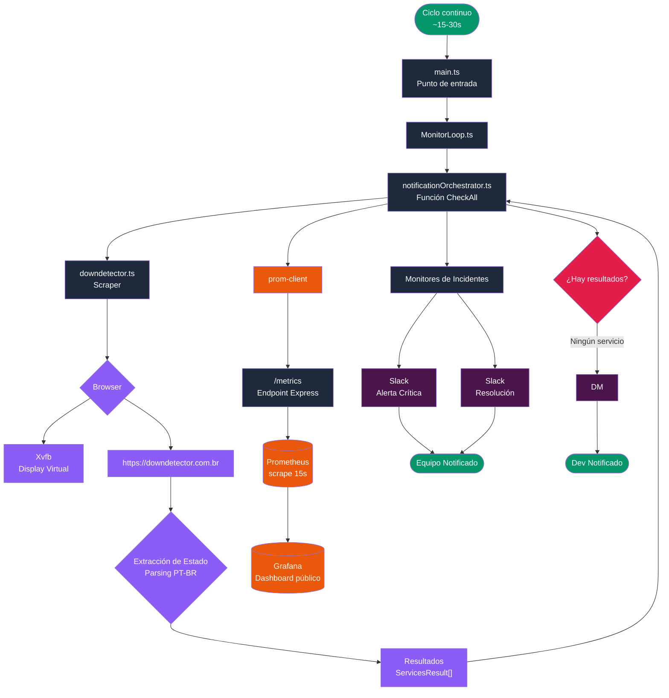

### Diagrama de componentes

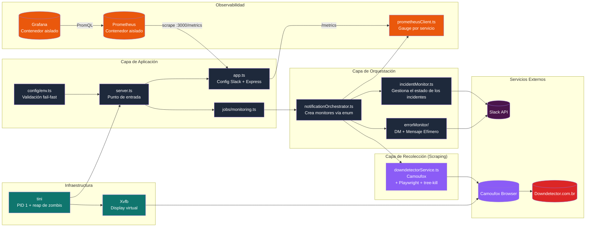

</details>

---

## Cómo funcionan las alertas

<details>
<summary>Haz clic para entender</summary>

Cada servicio tiene su propio monitor de incidentes que rastrea los cambios de estado:

| Estado en Downdetector | Qué significa                                                     | Acción en Slack                            | Valor en Grafana |
| ---------------------- | ----------------------------------------------------------------- | ------------------------------------------ | ---------------- |
| 🟢 **Success**         | Los reportes de usuarios **no indican problemas** con el servicio | Ninguna acción (estado normal)             | `0`              |
| 🟡 **Warning**         | Los reportes muestran **posibles problemas** con el servicio      | ⚠️ Solo se registra en el log (sin alerta) | `1`              |
| 🔴 **Danger**          | Los reportes muestran **problemas confirmados** con el servicio   | ☠️ **Alerta Crítica** enviada de inmediato | `2`              |

</details>

## Ejemplos visuales de los estados en Downdetector

<details>
<summary>Haz clic para ver cómo aparece cada estado en Downdetector</summary>

#### 🟢 Success → Servicio funcionando con normalidad

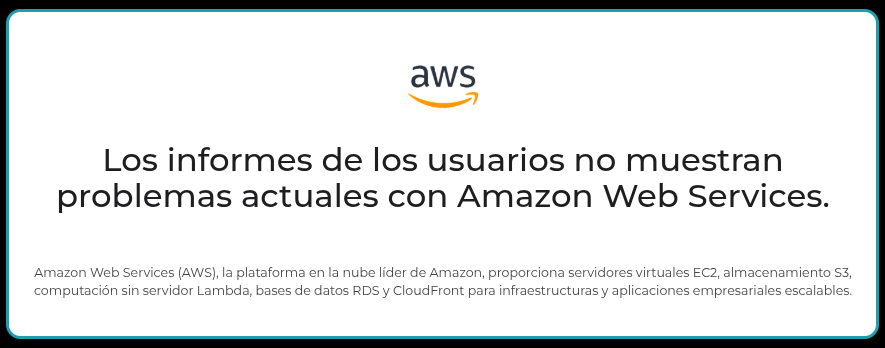

#### 🟡 Warning → Posibles problemas detectados


#### 🔴 Danger → Problemas confirmados

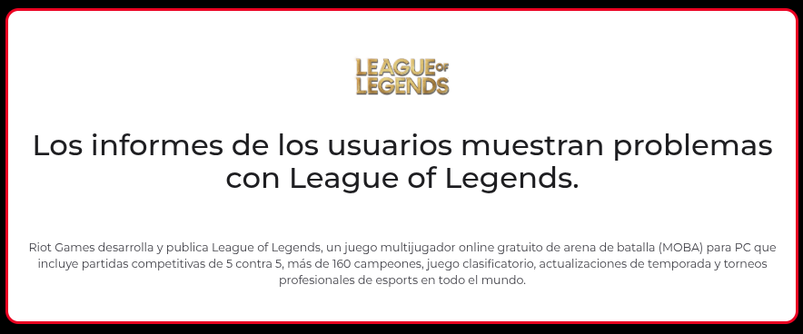

</details>

## Ejemplos de notificaciones en Slack

<details>
<summary>Haz clic para ver cómo aparecen las alertas en Slack</summary>

> ℹ️ Las alertas del bot siempre se envían **en portugués**, sin importar el idioma de este README: el texto está fijo en el código.

#### ☠️ Alerta Crítica (cuando el servicio entra en `danger`)


#### 🎉 Alerta de Resolución (cuando el servicio vuelve a `success`)


</details>

---

## Configuración

## Requisitos previos

- Node.js 22.15+ y [pnpm](https://pnpm.io/)
- Una app de Slack con Incoming Webhooks ([créala aquí](https://api.slack.com/apps))
- Docker (opcional, ejecuta el mismo entorno con Xvfb)

## Instalación

<details>
<summary>Haz clic para expandir las instrucciones de instalación</summary>

1. **Clona el repositorio**

```bash
git clone https://github.com/eduardotashiro/downdetector-slack.git
cd downdetector-slack
```

2. **Instala las dependencias**

```bash
pnpm install
```

3. **Descarga el navegador** (`pnpm install` no descarga el binario de Camoufox; el Dockerfile ejecuta el mismo comando)

```bash
npx camoufox fetch
```

4. **Configura las variables de entorno**

```bash
cp .env.example .env
```

Luego, completa el `.env` con los 3 webhooks (ver la siguiente sección):

```env
SLACK_WEBHOOK_ALERT_1=https://hooks.slack.com/services/...
SLACK_WEBHOOK_ALERT_2=https://hooks.slack.com/services/...
SLACK_WEBHOOK_ERROR=https://hooks.slack.com/services/...
```

5. **Compila el proyecto**

```bash
pnpm run build
```

6. **Inicia el bot**

```bash
pnpm start
```

</details>

### Webhooks de Slack

<details>
<summary>Haz clic para expandir las instrucciones</summary>

1. Ve a https://api.slack.com/apps y haz clic en **Create New App**

2. Créala desde cero, o elige **From an app manifest** y pega el contenido de [`manifest.yml`](manifest.yml)

3. En **Incoming Webhooks**, activa la opción y haz clic en **Add New Webhook to Workspace**, eligiendo el canal. Hazlo una vez por variable:

    - `SLACK_WEBHOOK_ALERT_1` y `SLACK_WEBHOOK_ALERT_2` → canales que reciben las alertas críticas y las resoluciones

    - `SLACK_WEBHOOK_ERROR` → canal que recibe los errores del propio bot

4. Copia cada URL al `.env`

> Documentación: [Envío de mensajes mediante webhooks](https://docs.slack.dev/messaging/sending-messages-using-incoming-webhooks/)

</details>

## Docker

<details>
<summary>Haz clic para expandir las instrucciones de Docker</summary>

Camoufox se ejecuta en modo **headed** (no headless) aquí, porque pasa Cloudflare de forma mucho más confiable. Como no hay pantalla física, la imagen de Docker lo ejecuta dentro de un display virtual (Xvfb).

**Solo el bot (build y ejecución local):**

```bash
docker build -t downdetector-slack .
docker run --rm -it --env-file .env downdetector-slack
```

**Stack completo local (bot + Prometheus + Grafana) vía Docker Compose:**

```bash
docker compose up --build
```

Esto levanta tres contenedores en la misma red (`monitoring`):

- `bot` → expone `:3000` (incluye `/metrics`)
- `prometheus` → `:9090`, hace scrape del bot cada 15s
- `grafana` → `:3001`, ya viene con el datasource y el dashboard provisionados automáticamente; login por defecto `admin` / `admin`, definido en [docker-compose.yml](docker-compose.yml)

No hace falta mapear el puerto del bot en producción, pues nunca recibe tráfico HTTP externo salvo el scrape de Prometheus (`/metrics`) y las peticiones salientes a Downdetector y a Slack.

</details>

---

## Modo de Uso

<details>
<summary>Haz clic para expandir ejemplos de uso</summary>

**Modo Desarrollo:**

```bash
pnpm run dev
```

Se ejecuta con hot-reload usando `tsx watch`. En Linux sin display, envuélvelo con `xvfb-run -a npm run dev`.

**Modo Producción:**

```bash
pnpm run build
pnpm start
```

> En la primera ejecución Camoufox descarga una base GeoIP (`geoip: true`), por lo que el primer ciclo tarda más.

</details>

---

## Observabilidad

> ⏸️ **Desactivada por ahora.** Los archivos de Prometheus y Grafana están en el repositorio, pero nada expone todavía el `/metrics`.

<details>
<summary>Haz clic para expandir/colapsar</summary>

Lo que ya existe:

- [`src/metrics/prometheusClient.ts`](src/metrics/prometheusClient.ts): un `Gauge` por servicio (`downdetector_service_status`), con la etiqueta `service` normalizada (minúsculas, sin acentos, espacios convertidos en `_`) mediante la función `normalizeServiceName()`
- [`monitoring/`](monitoring): configs de Prometheus (local y Railway) y dashboard de Grafana con provisionamiento automático

Para reactivarla:

1. Levantar un servidor HTTP que sirva el `metricsEndpoint` en `/metrics`, en el puerto 3000
2. Descomentar el bloque de métricas al final de `checkAllServices()`, en [`downdetector.ts`](src/providers/downdetector.ts)
3. Ajustar las rutas de [`docker-compose.yml`](docker-compose.yml) y de [`Dockerfile.grafana`](Dockerfile.grafana), que todavía apuntan a las carpetas antiguas (ahora es `monitoring/`)

### Métrica expuesta

```
# HELP downdetector_service_status Status do serviço monitorado pelo Downdetector: 0 = success, 1 = warning, 2 = danger
# TYPE downdetector_service_status gauge
downdetector_service_status{service="pix"} 0
downdetector_service_status{service="nubank"} 0
downdetector_service_status{service="banco_itau"} 2
```

### Dashboard de Grafana


El dashboard [`downdetector.json`](monitoring/grafana/provisioning/dashboards/downdetector.json) se carga automáticamente mediante el provider configurado en [`dashboards.yml`](monitoring/grafana/provisioning/dashboards/dashboards.yml), y muestra:

- Un panel `stat` por servicio, con color verde/amarillo/rojo según el estado actual (`SUCCESS` / `WARNING` / `DANGER`)
- Un panel `timeseries` con el historial de estados de todos los servicios en las últimas horas

El datasource de Prometheus también se provisiona automáticamente:

- Localmente, vía [`datasource.yml`](monitoring/grafana/provisioning/datasources/datasource.yml) (`http://prometheus:9090`)
- En Railway, vía [`prometheus-datasource.yml`](monitoring/prometheus/railway/prometheus-datasource.yml) (`http://prometheus.railway.internal:9090`)

### Corriendo localmente

```bash
docker compose up --build
```

- Grafana: [http://localhost:3001](http://localhost:3001) (login `admin` / `admin`)
- Prometheus: [http://localhost:9090](http://localhost:9090)
- Métricas crudas del bot: [http://localhost:3000/metrics](http://localhost:3000/metrics)

</details>

---

## Pruebas

<details>
<summary>Haz clic para expandir la guía de pruebas</summary>

**Ejecutar las pruebas:**

```bash
pnpm test            # Ejecuta las pruebas una vez
pnpm run test:watch  # Modo watch
```

**Probar alertas en tu canal de Slack:**
Envía una alerta DANGER real seguida de una resolución SUCCESS al canal configurado en tu `.env`, sin tocar los monitores de producción:

```bash
pnpm run test:alert
```

</details>

---

## Contribución

<details>
<summary>Haz clic para expandir</summary>

1. Haz un fork del repositorio
2. Crea una rama, haz commit (usa [Conventional Commits](https://www.conventionalcommits.org/)) y súbela:

```bash
git checkout -b feature/mi-feature-bacan
git commit -m 'feat: agrega feature bacan'
git push origin feature/mi-feature-bacan
```

3. Abre un Pull Request

**Convención de commits:** `feat`, `fix`, `docs`, `test`, `perf`, `refactor`, `chore`

**Antes de enviar el PR** (el CI ejecuta estos mismos dos comandos):

```bash
pnpm test
pnpm run build
```

</details>

---

## Licencia

Este proyecto está licenciado bajo la Licencia MIT - consulta el archivo [LICENSE](LICENSE) para más detalles.

---

<div align="center">

**Made with 💀 by [Eduardo Tashiro](https://www.linkedin.com/in/eduardo-tashiro-192096362/)**

⭐ **Star this repo if you find it useful!**

[](https://github.com/eduardotashiro/downdetector-slack/stargazers)

</div>
